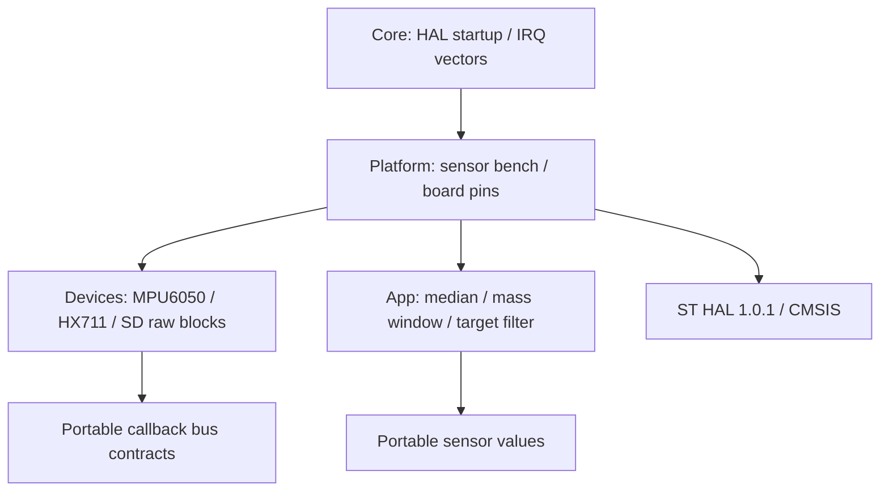

# Сенсорна архітектура ЛР 2

Core зберігає згенеровану ініціалізацію clock, GPIO, UART та IRQ; апаратний I2C init у стандартній конфігурації вимкнено (DP_HARDWARE_I2C не задано). USER CODE викликає dp_bench_start/poll. Platform містить ADC/TIM3/GPIO адаптери, номери пінів, UART RXring та команди bring-up. Devices отримує read/write/data/clock/delay/exchange callbacks, не включає HAL. App реалізує лише якість сенсорних даних: median3, window10, stale/movement reset та IIR. Повного автомата порцій тут немає. tools/check_dependencies.py забороняє включення HAL, main або Platform у App/Devices; make test запускає цю перевірку.

.ioc вручну синхронізовано з конфігурацією pinout. GUIгенерація CubeMX у цій сесії не запускалася. Після майбутньої регенерації зберегти USER CODE та Platform/Devices/App, звірити джерела в Makefile. Це не обіцянка автоматичної регенерації власного bench.

CMSIS/ST HAL взято з дозволеного SP-Boilerplate; HAL1.0.1. Додаткові ADC/ADCEx/LL_ADC - офіційний STMicroelectronics/stm32c0xx-hal-driver tagv1.0.1. Ліцензії збережено. Інші бібліотеки сенсорів не застосовано. ADC потрібен для PA0; I2C/UART/GPIO - інтерфейси продукту; RCC/CORTEX/FLASH/PWR - startup/clock; EXTI - згенерована кнопка; DMA - залежність HALтипів I2C/UART, передачDMAпоки немає. TIM3 налаштовано через регістри, тому HALTIM і HALSPI не підключені. Попередження unused-parameter придушено лише для двох відповідних vendor PWR/FLASHEx файлів, не у власному коді.

SD raw-sector probe перевіряє фундамент сховища, але не є журналом завершених порцій. ЛР 3 має додати state machine, CRC/recovery та вимірювання; ЛР 4 змінює організацію виконання зі збереженням цих інтерфейсів. Жодного RTOSядра немає.

Апаратний I2C у поточній моделі C031 не завершив ні HALMemRead,ні MasterTransmit; власні VCD показали ACK без завершення,HALerror0x20 та BUSY. Відомий issue: https://github.com/wokwi/wokwi-features/issues/744. Обхід локалізовано у Platform/dp_i2c_gpio.c: справжній I2C через HALGPIO open-drain PB8/PB9,ACK,NACK,repeatedSTART,burst,timeout і startupbusrelease. Devices/App не змінювалися через заміну адаптера. Це не перевірка апаратного I2Cконтролера і не підстава стверджувати працездатність такого обмеження на фізичній платі.

Для моделі STM32 GPIO_IDR не повертав коректний рівень звільненого open-drain виходу: VCD показував high, а цикл очікування бачив low. Адаптер реалізує release як HALGPIO input+pull-up, drive-low як open-drain output. Успішний self-test підтвердив WHO_AM_I0x68 та burst0,0,1000mg /24001m°C. Цей обхід не змінює протокол I2C чи сенсорні значення.
