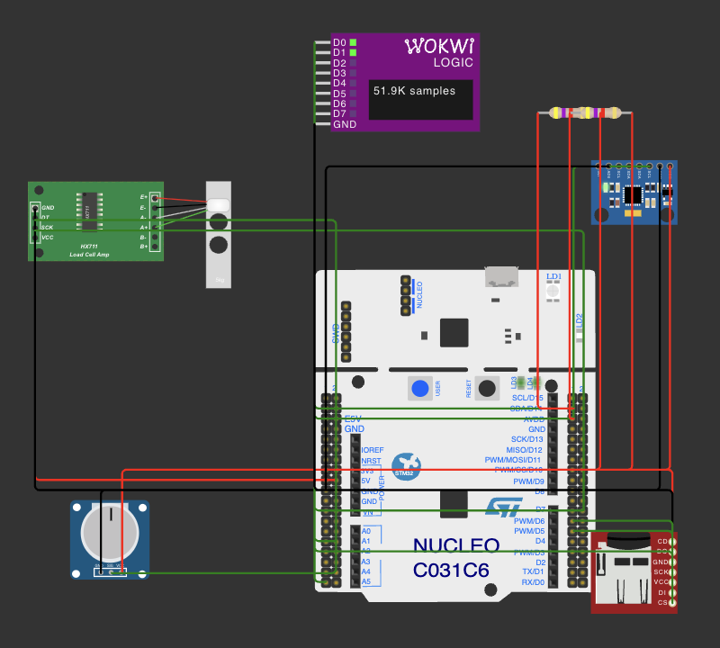
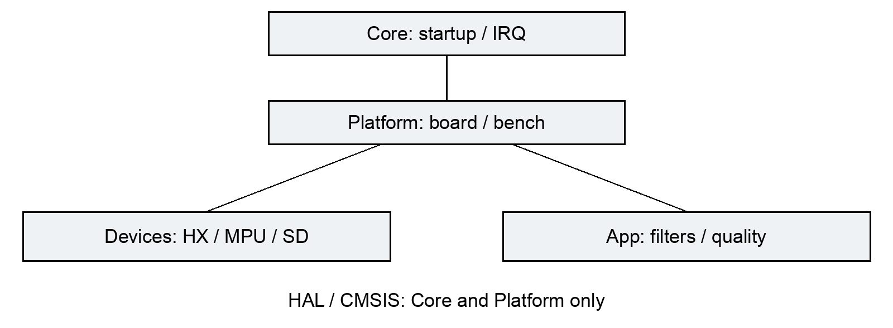
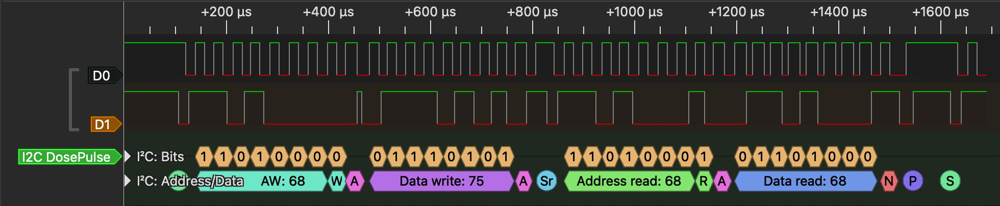
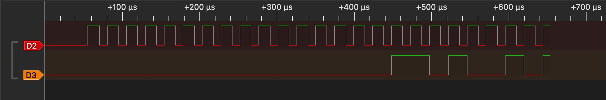
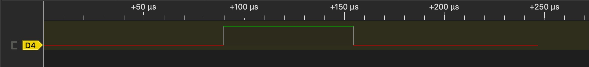
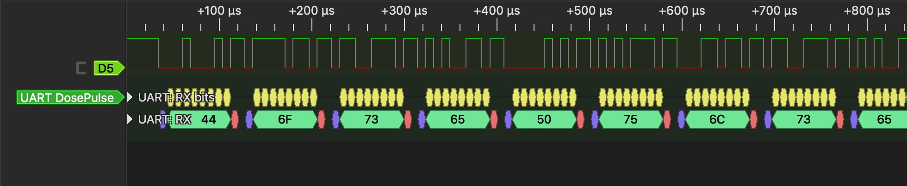
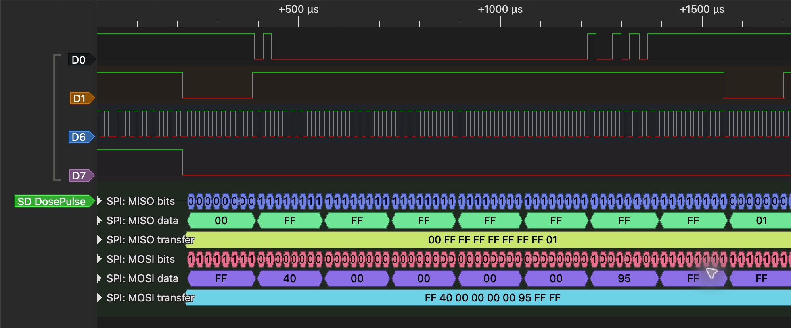
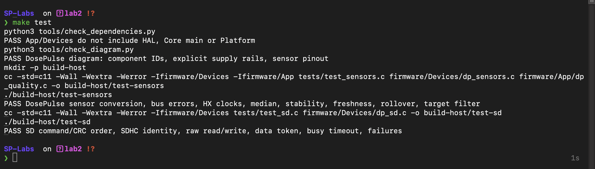

# DosePulse: лабораторна робота 2

інтегрувати сенсорний фундамент DosePulse на Nucleo-C031C6, перевірити сумісність підключення, справжній обмін на лініях і незалежно тестовані перетворення. Продукт призначений для обліку порцій за масою: оператор задає ціль потенціометром, HX711 вимірює платформу, MPU6050 забороняє прийняття нестабільної маси. У ЛР2 реалізовано стенд перевірки цих пристроїв та сирих блокових операцій SD. Автомат порцій, підтвердження оператора, журнал із CRC та RTOS належать наступним роботам.

Форма виконання - B, Wokwi. Узгоджене середовище: Ubuntu 24.04, Docker, STM32 HAL, Wokwi. Docker виконує ARM-збірку; macOS є хостом редактора, PulseView і host-тестів. Фізична плата не використовувалася. Камера у формі B відсутня; її інтерфейс і реальне живлення не перевірені. MCU збережено: STM32C031C6, Cortex-M0+, 32 KiB Flash, 12 KiB RAM.

Побудувати одночасне підключення всіх пристроїв PRD; обґрунтувати pinout, живлення та щонайменше дві відхилені розкладки. Перевірити ідентифікацію, ініціалізацію, правдоподібність даних і self-test. Зберегти трафік інтерфейсів, декодування, ручні біти, часові параметри та аномалію. Відокремити апаратні адаптери від portable-драйверів і логіки, перевірити залежності, власні тестові вектори, покриття та CI.

# Схема та аргументація підключення

Повна відтворювана схема - diagram.json; розширена таблиця з роз’ємами й альтернативними функціями - docs/pinout.md. Підстави: ST DS13867, таблиці 12, 13, 15 (корпус і функції); UM2953, рисунок 7 і таблиця 11, с. 19-20 (роз’єми плати); RM0490, розділи RCC, GPIO, ADC, USART, TIM (налаштування блоків). Приклад трьох рівнів перевірки: PA0 має ADC1_IN0 у кристалі, виведений як A0/CN8-1 на платі, а ADC тактується PCLK/4 відповідно до RM.

| Пін та режим | З’єднання і причина |
| PA0, analog | Потенціометр SIG, A0/CN8-1; 0-3,3 V, без pull. Не займає UART або SD CS. |
| PA1, input; PA8, output | HX711 DT та SCK; PA1=A1/CN8-2, PA8 - morpho, UM2953 Fig.7. DT має підтягування до 3,3 V, SCK початково low. |
| PB8/PB9, GPIO open-drain | MPU6050 SCL/SDA, D15/CN5-10 та D14/CN5-9. Доступна AF6 I2C1; фінальний обхід моделі використовує GPIO на тих самих проводах. По 4,7 kΩ до 3,3 V. |
| PA2/PA3, AF1 USART2 | TX/RX, збережений serial/VCP заготовки; 115200, 8N1. Це не D1/D0, які на цій платі відповідають PB6/PB7. |
| PB3/PB4/PB5, GPIO | SD SCK/MISO/MOSI, D3/CN9-4, D5/CN9-6, D6/CN9-7; mode 0, 3,3 V. Залишається можливість AF0 SPI1 без перестановки проводів. |
| PA4, output high | SD CS, A2/CN8-3; незалежне утримання low на всю команду й відповідь. |
| PA5; PB0, output | Вбудований LED D13/CN5-6; маркер ADC D10/CN5-3. Не розділяють роль SD SCK або CS. |

Інструкція монтажу: спочатку спільна GND; далі 3,3 V потенціометра, MPU6050 та SD; потім сигнали за таблицею. AD0 MPU6050 з’єднано з GND: адреса 0x68, WHO_AM_I за регістром 0x75 дорівнює 0x68. HX711 не має адреси або ID-регістру: перевіряються READY, 24 біти та 25-й такт вибору A/128. Потенціометр - пасивний компонент, його ідентифікація електрична, а не регістрова. Для SD перевіряються R7/CMD8 і OCR/CMD58, а не JEDEC ID SPI NOR.

У Wokwi HX711 має VCC 5 V відповідно до моделі. На фізичному модулі потрібно забезпечити DVDD=3,3 V або узгодження рівнів; не подавати 5 V на PA1 без перевірки електричної схеми. Типове споживання малосигнальної частини оцінено приблизно у 9,1 mA з резервом до 20 mA; це розрахунок, а не вимір. Для microSD передбачено окреме стабілізоване 3,3 V із початковим запасом щонайменше 200 mA, спільною землею та локальним розв’язуванням. Реальний піковий струм залежить від вибраної карти й має бути виміряний. Ідеальне джерело симулятора цього не доводить.

Дві пари модульних підтягувань 4,7 kΩ паралельно дадуть 2,35 kΩ; їх не слід додавати автоматично. Номінал на фізичній шині перевіряють за ємністю, допустимим струмом low і часом наростання осцилографом. Open-drain дозволяє ACK і спільне керування SDA; push-pull створив би електричний конфлікт між master і slave.

Відхилено SPI на PA5/PA6/PA7 через конфлікт SCK з LED PA5; HX711 на PA2/PA3 - через UART; ADC на PA4 - через SD CS. SWD PA13/PA14, кнопка PC13 та кварцові входи не зайняті сенсорами. DMA-передач немає. TIM3 має одну роль: короткі мікросекундні затримки.

# Тактування, драйвери та архітектура

HSI/AHB/APB = 48 MHz. UART BRR ≈ 48 MHz / 115200 = 416,67. TIM3: PSC=47, ARR=65535, частота 1 MHz; це короткий таймер, не DWT і не готовий довготривалий лічильник. ADC: PCLK/4=12 MHz, (79,5+12,5)/12 MHz ≈ 7,667 µs без HAL-накладних витрат. GPIO I2C має паузи 5 µs плюс виконання коду; SPI mode 0 - дві паузи 2 µs на біт плюс GPIO-код, тому 250 kHz є лише верхньою оцінкою. Виміряні частоти наведено нижче.

Апаратний I2C моделі C031 не завершував ні HAL MemRead, ні окремі передавання та приймання: VCD показував ACK, але драйвер отримував timeout, ISR=0x8043. Відоме обмеження моделі наведене у wokwi-features#744. Обхід локалізовано в Platform/dp_i2c_gpio.c: справжні START, ACK/NACK, repeated START та STOP через ті самі PB8/PB9. Release реалізовано як input із pull-up, drive-low - як open-drain output, оскільки IDR моделі некоректно читав звільнений OD-вихід. Це перевірка сигналів GPIO-адаптера, а не доказ роботи апаратного I2C1.

Core містить startup, clock, GPIO, USART та IRQ; апаратна I2C-ініціалізація вимкнена в стандартній конфігурації. Platform знає піни, HAL, таймер, UART-чергу та команди стенда. Devices отримує callback-контракти шин без HAL. App містить медіану, вікно стабільності та фільтр цілі. Залежності формально перевіряє tools/check_dependencies.py: App/Devices не можуть включати HAL, main або Platform. Тест запускається через make test.

CMSIS і ST HAL 1.0.1 збережено з дозволеної заготовки; ADC/ADCEx/LL_ADC додано з офіційного тега ST v1.0.1. Версії, SHA та ліцензії зафіксовано у docs/vendor-versions.json. Потрібні GPIO, UART, ADC, I2C-типи та startup-модулі RCC, CORTEX, FLASH та PWR; DMA лишається залежністю типів HAL, без активних передач. HAL TIM/SPI не підключено: ці адаптери використовують регістри/GPIO. Два unused-parameter попередження придушено лише для відповідних вендорських PWR/FLASHEx-файлів. Власний код збирається з -Wall -Wextra без попереджень.

Файл .ioc синхронізовано вручну; GUI-генерація CubeMX не виконувалася. USER CODE викликає dp_bench_start/poll, власні шари винесені з Core. Після регенерації необхідно звірити .ioc, Makefile й USER CODE; автоматичне відтворення всього bench з одного .ioc не заявляється.

# Ідентифікація, одиниці та спільне опитування

MPU6050: WHO_AM_I=0x68; PWR_MGMT_1=0, DLPF=3, gyro ±250 °/s, accel ±2 g, SMPLRT_DIV=19. Читання 14 байтів від 0x3B кожні 20 ms; прискорення = raw/16384 g, гіроскоп = raw/131 °/s, температура = raw/340+36,53 °C. UART використовує milli-g, mdps і m°C. У спокої отримано (0;0;1000) milli-g, модуль рівно 1 g у моделі, та 24,001 °C. Це правдоподібність модельних даних, не калібрування реального IMU.

HX711: перевірка READY кожні 10 ms, дані моделі 10 SPS, 24 біти MSB-first і 25-й такт A/128. Знакове розширення, крайні насичені коди та NOT_READY обробляються окремо. Модельна калібровка: 5 kg = 2100 counts; один count ≈ 2,381 g. Формат mg не означає міліграмову точність. ADC опитується кожні 100 ms, raw 0-4095 → 0-3300 mV та округлена ціль 100-1000 g.

| Вхід Wokwi | HX raw / маса | ADC raw / mV / ціль | Результат |
| 0,25 kg; knob 0 | 105 / 250000 mg | 0 / 0 / 100 g | imu=0, hx_ok=1, stable=1 |
| 0,5 kg; knob 512 | 210 / 500000 mg | 2050 / 1652 / 551 g | imu=0, hx_ok=1, stable=1 |
| 1 kg; knob 1023 | 420 / 1000000 mg | 4095 / 3300 / 1000 g | imu=0, hx_ok=1, stable=1 |
| 0,5 kg; accelX=0,25 g | 210 / фільтр заморожений | Звичайне опитування ADC | moving=1, stable=0 |

Це окремі реальні старти зі статичними входами diagram.json, а не запис переходів ручки під час одного запуску. Вхідні JSON, UART та VCD збережено для кожного випадку. Динамічне скидання вікна перевірене host-тестами. Медіана 3 усуває одиничний викид; стабільність потребує 10 значень із розмахом ≤10 g та щонайменше 1000 ms безперервного спокою. Поріг руху: |ax|+|ay|+|az-1000| >150 milli-g або будь-яка |ω|>10 °/s. Дані маси старші 350 ms чи IMU старші 100 ms скидають валідність. Під час руху поле mg зберігає попередній фільтрований результат, а raw hx залишається фактичним; stable=0 забороняє прийняття. Ціль має IIR 1/4. Ці пороги походять із PRD і потребують перевірки на реальній механіці.

Фінальна інтеграція триває до MCU t=34127 ms: selftest, anomaly, tare, fault, recover, sdprobe, неправильна команда, рядок 80 символів, sdread, counts. Зафіксовано регістр ідентифікації, NACK на 0x69, повернення 0x68, явні ERR, успішний SD readback і кінцеві hx_ok=1, imu=0, stable=1. Первинний UART - docs/evidence/lab2/integration-delivery.raw; автоматичний підсумок містить команди, MCU-час та SHA256 ELF.

# Метод вимірювання сигналів

Wokwi logic analyzer записує подієвий VCD із часовою шкалою 1 ns. Це одиниця формату, а не фізична точність. Для sigrok/PulseView використано 2 MHz (downsample=500), квантування 0,5 µs. На найшвидшому використаному UART 115200 це приблизно 17 вибірок на біт. Тригер - старт симуляції; зупинка після потрібних команд. Для фізичного аналізатора потрібні спільна GND, перевірка рівнів і частота дискретизації щонайменше у 8-10 разів вища за частоту шини.

Основна карта: D0=SCL, D1=SDA, D2=HX_SCK, D3=HX_DT, D4=ADC marker, D5=UART TX, D6=SD SCK, D7=SD CS. В окремому SD-записі D0=MOSI, D1=MISO. Вхідні diagram JSON збережено. Часові префікси VCD отримано без зміни фронтів або timestamps; поруч записано SHA первинного файлу. .sr - імпорт справжнього VCD. Текстове декодування sigrok і незалежні скрипти читають ті самі переходи; вони не синтезують осцилограми.

Ідентичність фінального ELF для integration-delivery та sd-probe: e05292f56606e9616dabc927fed1b138d5f9d1b7be86b0961141b2bdc6137945. Дві чисті збірки дали однакові ELF/HEX/BIN. FLASH=23488 B (71,68%), RAM за linker memory report=3304 B (26,89%); це статичний бюджет, не вимір стека під навантаженням. Калібрувальні старти 250/500/1000 g і статичний рух виконані попереднім ELF 4a959079871d156de4b3f3a5aa9b03881cd0ffd26092d0b97d2a6166eb1b32da. Подальше виправлення стосувалося UART IRQ; їхні первинні записи збережено з власною ідентичністю, а не перепозначено новою.

Для читабельних кадрів PulseView з первинного VCD виділено точні часові вікна. Початковий стан перенесено з останнього попереднього переходу, час зсунуто до нуля вікна; JSON provenance містить SHA256 джерела й початковий MCU/VCD час. Це геометричні фрагменти реального інтерфейсу декодера. Для I2C початок вікна 9,5 ms, UART 3,25 ms, ADC 2,5 ms, HX 103,94 ms, SD 2117,6 ms; до показаного часу потрібно додати відповідний зсув.

# I2C: байти, час та аномалія

Ручне декодування WHO_AM_I: SDA падає при SCL=1 - START. Вісім бітів 11010000 = 0xD0: адреса 0x68, W=0; дев’ятий low - ACK. Далі 01110101 = 0x75 і ACK. Повторний START, 11010001 = 0xD1: та сама адреса, R=1, ACK. Slave відповідає 01101000 = 0x68. Дев’ятий high від master - штатний NACK перед STOP, а не помилка ідентифікації.

Burst 0x3B: 00 00 00 00 40 00 EF 5C 00 00 00 00 00 00. 0x4000=16384 дає 1000 milli-g по Z; signed 0xEF5C=-4260 дає 24001 m°C за цілочисловою формулою; гіроскоп нульовий. Ці самі 14 байтів використовуються як реальний вектор у tests/fixtures/mpu_wokwi.h та збігаються з UART.

Намерена аномалія - адреса 0x69: 11010010 = 0xD2, дев’ятий біт high означає NACK slave. fault лишає цю адресу, recover повертає 0x68; кінцева валідність відновлена. Це програмна ін’єкція неправильної адреси, а не фізичне від’єднання датчика. Фінальний VCD містить 1585 повних 14-байтних читань: min/mean/max 4,996/5,010/7,127 ms. Період SCL у 243072 інтервалах: 33,0/36,803/140,0 µs, середня частота близько 27,2 kHz. Наївні дві паузи 5 µs дали б 100 kHz; різниця пояснюється GPIO-кодом і перериваннями. Початковий TIMINGR апаратної спроби не задає частоту цього адаптера.

# HX711, ADC та UART

У записі маси 500 g вручну прочитано 00000000 00000000 11010010 = 210 counts. 25-й імпульс обирає A/128; це не 25-бітне число. Окремі 250 g і 1000 g дають 105 та 420 counts. Фінальний нульовий запис містить 345 повних 25-тактових слів; приклад тривалості - 814,75 µs. Запитувані паузи 2 µs не описують повну тривалість GPIO-викликів. Переривання маскується лише на high-фазі SCK, щоб не розтягнути її до powerdown, але дозволити UART RX між імпульсами.

У ADC немає цифрового протоколу. PB0 високий навколо start/poll/get/stop. Для 344 імпульсів min/mean/max ширина 63,175/66,106/67,175 µs проти теоретичних 7,667 µs лише перетворення; маркер включає HAL. Для 343 інтервалів період 93,830/101,369/350,423 ms. Максимум виникає біля блокової SD-операції: bench не доводить дотримання всіх дедлайнів майбутнього продукту. У ЛР 3 це має стати окремим експериментом з обмеженням блокування.

UART декодується як 115200, 8 data bits, no parity, 1 stop bit; рядки SELF, DATA та SDPROBE зіставлено з первинним RFC2217-логом. Один біт номінально 8,681 µs. Host-час прибуття не використовується як MCU-час. Неправильна та надмірно довга команди отримують ERR; після UART overrun частковий рядок відкидається, приймання поновлюється й помилка рахується.

# SPI та фактичний запис SD

SPI mode 0: SCK idle low, захоплення на rising edge, CS low охоплює команду й відповідь. CMD0: 40 00 00 00 00 95 → R1=01; CMD8: 48 00 00 01 AA 87 → echo 000001AA; далі CMD55/ACMD41 та CMD58. CMD24 сектора 4096: 58 00 00 10 00 01, token FE, 512 байтів шаблону (i×37+19) mod 256, два байти CRC при вимкненій перевірці CRC; data response=05, busy low. CMD17: 51 00 00 10 00 01, token FE і 512 байтів. WREN належить SPI NOR; для SD такої команди немає.

Окремий експеримент почався з нульового disposable-образу 8 MiB. Перше читання повернуло 512 нулів; після запису всі 512 байтів MOSI і повторного MISO збігаються із шаблоном. FNV-підсумок змінився з 4d7705c5 на f7e51dc5; це контроль тестового payload, не CRC журналу продукту. Негайна команда sdread після відповіді sdprobe також успішна. Після зупинки Wokwi сектор записаного образу перевірено незалежно. JSON містить SHA256 payload і образу; сирі дані та декодування збережено.

Для 17858 періодів SCK отримано min/mean/max 19,5/21,090/28,5 µs, близько 47,4 kHz у середньому. Це повільніше за верхню оцінку 250 kHz через HAL/GPIO та накладні витрати. Справжня передача й busy перевірені, але filesystem, кільцевий журнал 32 записів, atomic commit та відновлення після вимкнення під час запису ще не реалізовані. ЛР 2 не підміняє ці вимоги штучною затримкою.

# Host-тести, покриття та збірка

make test виконує перевірку залежностей і схеми, потім два portable C executables із -Wall -Wextra -Werror. assert.h дає прозорі твердження без стороннього runner; натомість немає автоматичних назв кейсів, fixture lifecycle чи mocking DSL. Fake I2C повертає синтетичні помилки й власний реальний 14-байтний вектор. Mock SD перевіряє порядок команд, аргументи, CRC7 початкових команд, payload, rejected token, timeout та busy. Перевірено знаковість, насичення HX, 25 тактів, ADC endpoints, медіану, рух, застарівання, rollover та IIR. Це перевірки алгоритмів, а не підміна апаратного запуску.

Попередньо обраний поріг ≥80% рядків і ≥80% гілок у кожному Devices/App модулі забезпечує перевірку нормального та основних помилкових шляхів, проте не гарантує відсутності дефектів. Фактичне gcov/llvm-cov покриття:

| Модуль | Рядки | Гілки |
| dp_sensors.c | 38/38, 100% | 24/24, 100% |
| dp_sd.c | 45/45, 100% | 50/52, 96,15% |
| dp_quality.c | 35/35, 100% | 50/58, 86,21% |

Platform/Core/HAL не включені в host-покриття: вони залежать від MCU-регістрів і перевірені окремо ARM-збіркою та Wokwi. CI налаштовано на make build, make test і make coverage для pull request та push у lab1/lab2. Локальне проходження цих команд зафіксовано; конфігурація workflow сама по собі не є доказом успішного віддаленого запуску.

# Журнал виявлених проблем

| Симптом і причина | Виправлення та перевірка |
| Схема містила імена рейок без суфікса, тому з’єднання не відповідали моделі Nucleo. | Використано 3V3.1/5V.1/GND.1; check_diagram і справжні старти підтвердили підключення. Коміт 964b7fc. |
| Апаратний I2C ACK-нув, але лишився BUSY; обмеження моделі C031. | GPIO-адаптер на тих самих проводах; ID, burst і NACK перевірені VCD, sigrok та UART. Коміти 964b7fc, 2913fb8. |
| Повний HAL_GPIO_Init на кожний фронт розтягував burst до 23-26 ms і порушував бажаний період 20 ms. | Початкова HAL-конфігурація та коротке перемикання MODER; фінальний mean 5,010 ms. Коміт 2913fb8. |
| Рідке опитування READY HX711 пропускало модельну готовність. | Перевірка READY кожні 10 ms за незмінних 10 SPS; реальні raw та stable підтверджено. Коміт 2913fb8. |
| Під час цілого HX-кадру були вимкнені IRQ; UART втрачав негайну sdread і міг не поновити RX після overrun. | IRQ маскується тільки на SCK high; додано ErrorCallback і відкидання часткового рядка. Негайний SD readback та фінальна інтеграція пройшли. Коміт 8538e22: firmware/Platform/dp_bench.c, HAL_UART_ErrorCallback/hx_clock. |
| Перший валідатор визнав hxoff/hxon успішним лише за ACK команд, хоча READY не відновився. | Вердикт скасовано, невдалий запис збережено окремо. Фінальний валідатор перевіряє стан усіх датчиків наприкінці; powerdown лишається виміряним обмеженням. |

# Розподіл напрямів

| Напрям | Відповідальний |
| Звіт і документація; pinout і джерела | Водопʼянов Ярослав Сергійович, ІО-32 |
| Інтеграція пристроїв; логічний аналізатор | Водопʼянов Ярослав Сергійович, ІО-32 |
| Архітектура; тести й CI | Водопʼянов Ярослав Сергійович, ІО-32 |

# Першоджерела та відтворення

Первинні джерела та їхні сторінки наведено у розділах підключення й протоколів. Виправлення: https://github.com/yaroslav1211/DosePulse/commit/2913fb8 та https://github.com/yaroslav1211/DosePulse/commit/8538e22. Документація PulseView: https://sigrok.org/doc/pulseview/0.4.2/manual.html. Бібліотеки й ліцензії: docs/vendor-versions.json.

# Висновки

Сенсорний фундамент підтверджено на рівні host-тестів, ARM-збірки, UART та незалежних сигналів Wokwi. HX711, MPU6050 й ADC працюють разом; SD реально записує та повторно читає 512 байтів, збережених у writeback-образі. Покриття portable-модулів перевищує обраний поріг 80% рядків і гілок. Обмеження: апаратний I2C1 моделі замінений GPIO-адаптером; окремий hxoff/hxon не відновив READY; фізичне живлення, шум і калібрування не перевірені. Блокуючий SD probe створює інтервал ADC до 350,423 ms, тому дотримання всіх дедлайнів повного продукту не доведене. Автомат порцій, журнал з CRC, power-cut recovery та досліди S1/S2/S3 залишаються наступним етапом. RTOS не додано.
