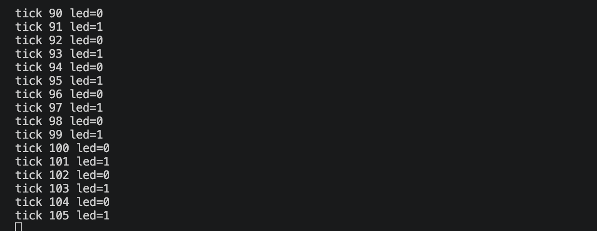
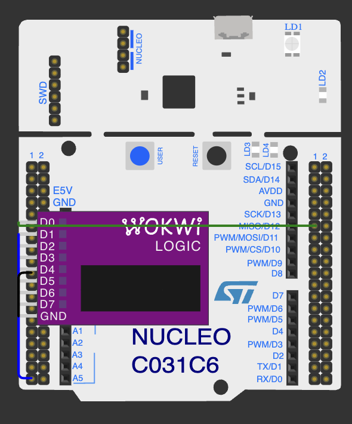

# DosePulse: лабораторна робота 1

Підготувати відтворювану збірку DosePulse для Nucleo-C031C6 і перевірити перший обмін із симульованим мікроконтролером. Окремий результат - вимоги ручного фасування за масою, стабілізацією та рухом платформи. Середовище: Ubuntu 24.04, Docker, STM32 HAL, Wokwi. Форма B. Фізичне обладнання не використовувалося.

Обрати тему й сенсори, сформулювати PRD та план лабораторних, обґрунтувати компоненти первинною документацією. Зберегти стартову плату Nucleo-C031C6, налаштувати Docker/Git, отримати відтворювані ARM-артефакти та перевірити UART/LED окремим запуском. Зберегти власні вимірювання та розібрати щонайменше п’ять фактичних труднощів.

# Продукт і план

DosePulse визначатиме нетто від явно заданої тари, фіксуватиме ціль на початку порції, очікуватиме стабільне вікно та формуватиме один висновок до зняття вантажу. HX711 передає масу через GPIO DT/SCK; MPU6050 через I2C перевіряє рух платформи; потенціометр ADC задає ціль 100..1000g. UART/LED є службовим інтерфейсом. Автомат порцій та постійний журнал належать наступному етапу.

| Вимога | Критерій кінцевого продукту |
| FR-01/02 | Нетто від тари; mass poll100ms; давність 350ms; стабільне вікно 1000ms, розмах<=10g,>=10зразків. |
| FR-03/04 | Ціль 100..1000g; MPU20ms; рух>150mg або 10deg/s блокує приймання; реакція<=100ms. |
| FR-05/06 | Допускmax(10g,2%цілі); один результат до зняття вантажу на 1000ms. |
| FR-07/08/09 | Команди<=63bytes; status/tare<=150ms; export32<=2s; SDCRC/read-back<=1000ms; startup/recovery<=1500ms. |

Числа є приймальними критеріями проєкту. ЛР 1 їх не вимірює. План: ЛР 2 - драйвери, одиниці, фільтри, self-test і сигнали; ЛР 3 - повний bare-metal продукт та S1/S2/S3; ЛР 4 - той самий продукт на FreeRTOS і порівняння. PRD містить дев'ять FR та конкретні граничні сценарії.

# Компоненти та аргументація

HX711 обрано замість прямого 12-bitADC для тензомоста: потрібне підсилення диференційного сигналу. MPU6050 спостерігає платформу; PIR показував би рух оператора. Потенціометр дає безперервну ціль; кнопка сама цього не забезпечує. Базова плата має 32KiBflash і 12KiBRAM, тому великий framebuffer або приклади Cortex-M4 не переносилися.

HX711 передає знакове 24-бітне число при 10 SPS; settling time становить 400 ms, 25 імпульсів обирають канал A з підсиленням 128. ID-регістру немає. У моделі Wokwi 5 kg відповідають 2100 counts, один count дорівнює приблизно 2,381 g. Отже, допуск 10 g - близько чотирьох counts, а не доказ грамової точності. MPU6050 має адресу 0x68; регістр WHO_AM_I за адресою 0x75 повертає 0x68. Діапазони: ±2 g та ±250 °/s. Потенціометр 10 kΩ при 3,3 V споживає 0,33 mA. План живлення та сторінки datasheet наведено у docs/hardware-components.md. Симулятор не перевіряє піковий струм, шуми, рівні готового 5 V модуля та реальну точність ваги.

# Збірка та відтворюваність

Дозволена стартова заготовка SP-Boilerplate походить від wokwi/stm32-hello-wokwi; її HAL/CMSIS, ліцензії,.ioc та linker збережені. Для власного запуску додано назву DosePulse і фактичний рівень LED у tick. Dockerfile використовує Ubuntu24.04 з arm-none-eabi-gcc; make запускається від UID/GID користувача. Не потрібні Arduino чи зміна MCU.

Виконано make clean -> make build двічі; окремо збережено повні логи та SHA256 ELF/HEX/BIN. Усі три файли збіглися побайтно, reproducibility.diff порожній. Результат стосується цього образу й тулчейну; повторюваність майбутнього apt-репозиторію не випробувана.

| Артефакт | SHA256 |
| ELF | b4741108afee561a386d10c7c8059e575847c6e67fbefbe607910e08dfc6da66 |
| HEX | 60b3522dae7fe5389dc4c860cbe66bbeb650db9cad2efbaa184725b4030807d3 |
| BIN | 3a650f9e752adbfdf042bd637c82ec3a0d82888434d6feb5547ae19cf90870f8 |

За arm-none-eabi-size: text = 13144 B; data = 112 B; bss = 2120 B. Flash (text + data) займає 13256 B. Сума data + bss = 2232 B не є виміряною глибиною стека. ELF запущено окремо у Wokwi; успішна компіляція сама по собі не доводить UART/LED.

# Перевірка Wokwi

Власний RFC2217збір отримав tick3..7 з чергуванням led1/0. Аналізатор підключено: D0=PA5LED, D1=PA2UART, GND=спільна земля; запис стартує разом із симуляцією. VCD має шкалу 1ns та 106.058s до останнього фронту. Sigrokдекодування UART1152008N1 з downsample1000 (1MHz) містить ASCIIбайти DosePulse і tick. LEDповторює повний цикл приблизно 2.004s; невелика надбавка пояснюється блокуючим printf перед HAL_Delay1000. Перший фронт ініціалізації виключається з оцінки періоду.

Артефакти: docs/captures/lab1-uart-led.vcd; docs/evidence/lab1/uart.raw, uart-decoded-1MHz.txt, vcd-summary.json, build-final-a/b.log. VCD та UARTналежать запуску DosePulse. Час VCD не є часом фізичної плати.

# Журнал складнощів

1. Вихідний README називав проєкт неперевіреним. Причина - підготовка містила лише заготовку. Виконано дві чисті збірки, результати збережено; стан уточнено на підставі доказів.

2. Origin спочатку відповідав Repository not found. Репозиторій ще не був створений; після створення власником ls-remote пройшов. Identity, SSHalias та remote не змінювалися.

3. Ізольований VSCode не стартував: EINVAL у listen. UNIXsocket профілю перевищив 103символи. Тимчасовий профіль перенесено до короткого/tmpшляху; прошивка і основний репозиторій залишилися на місці.

4. Pythonу папці проєкту не мав pyserial. Shell вибирав інший інтерпретатор. Створено окреме локальне середовище; UARTзбір виконано ним, залежності монітора зазначено у README.

5. Пряме завантаження TDKповертало HTMLперенаправлення замість registermapPDF. Перевірено зміст документа і сторінки через доступне представлення; HTMLне використано як технічне джерело. У таблиці залишено первинні URLта обмеження доступу.

# Першоджерела та відтворення

Використано AVIA HX711, с. 2-6; TDK register map, с. 11, 13-15, 29-31, 40, 45; ST DS13867, табл. 12-15; UM2953, с. 12-20; Bourns 3386, с. 1-2. Реалізація та докази: https://github.com/yaroslav1211/DosePulse/commit/cf1b78b.

# Висновки

Дві чисті збірки дали ідентичні ELF, HEX і BIN; UART та LED перевірено у Wokwi окремим запуском. Визначено три різні сенсорні ролі та дев’ять вимірюваних FR. ЛР1 підтвердила відтворюваний bring-up, а не реалізацію маси, руху, порцій або журналу. Симулятор не встановлює електричної сумісності реального 5 V модуля HX711 та точності ваги. Наступний етап перевіряє самі пристрої та їхні сигнали.
